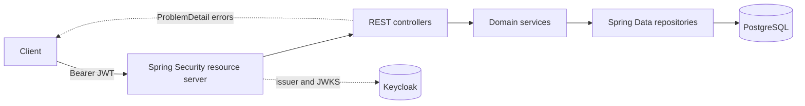
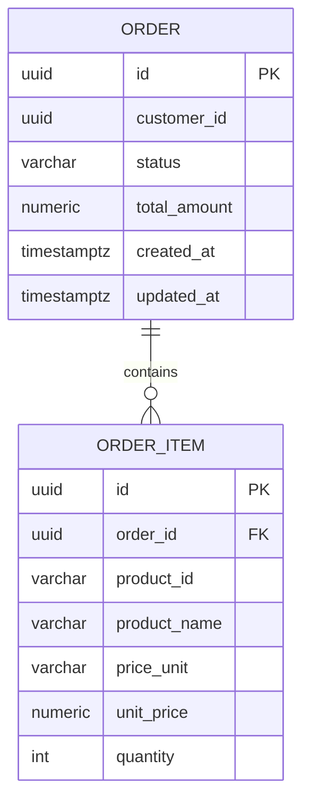

# Design — Order Management Service

## 1. Requirements understanding

A versioned REST API over a small order domain. PostgreSQL persists orders, Keycloak
issues JWTs, Spring Security enforces the rules.

- CUSTOMER creates orders and reads only their own.
- SUPPORT reads orders across customers; ADMIN reads all orders and advances status.
- An order has one or more items, each with quantity, unit price and a server-computed total.
- Lifecycle: `CREATED → CONFIRMED → SHIPPED → DELIVERED`.

## 2. Assumptions and clarifying questions

The specification contradicts itself in three places; these are the resolutions.

| Ambiguity | Resolution |
|---|---|
| SUPPORT changes status (scenario) vs ADMIN only (status section) | ADMIN only; SUPPORT is read-only |
| Listing all orders: ADMIN (API section) vs SUPPORT (scenario) | SUPPORT and ADMIN |
| `GET /api/{userId}/orders` lets a customer probe IDs | `GET /api/v1/customers/{customerId}/orders`; a CUSTOMER may only pass their own ID |

Further assumptions:

- **Product data** is supplied by the caller; the service owns no catalog.
- **Admin operations** are listing all orders and updating status. There are no delete,
  user-management or product-admin endpoints.
- **Money:** `BigDecimal` and `NUMERIC(12,2)`, `HALF_UP`, one implicit currency.
- **Identity:** `customer_id` is the Keycloak `sub` (a UUID); a token carries exactly one
  business role and Keycloak default roles are ignored.
- **Scope:** single tenant; customer isolation is the only row-scoping rule.
- **Price units:** `PIECE`, `KILOGRAM`, `LITER`; no conversion.
- **Limits:** 1–100 items, quantity 1–10,000, unit price with at most 2 decimals, total
  must fit `NUMERIC(12,2)`.

## 3. High-level architecture



A stateless Spring Boot service with a layered structure; each layer has one job.

| Layer         | Responsibility                                                       |
| ------------- | -------------------------------------------------------------------- |
| `api`         | controllers, validated DTOs, mapping, pagination, RFC 9457 errors    |
| `domain`      | `OrderStatus` state machine, totals, transactions, domain exceptions |
| `persistence` | JPA entities and Spring Data queries                                 |
| `security`    | JWT role conversion, current-user extraction, authorization bean     |
| `config`      | security filter chain and JPA auditing                               |

## 4. Data model



- Singular table names; `"order"` is quoted because `ORDER` is reserved.
- `order_item` holds one row per line with a snapshot of the product data, so a later
  change in the product service cannot rewrite history.
- Indexes: `order(customer_id)`, `order(status)`, `order(created_at DESC)`,
  `order_item(order_id)`. Items are never queried by product, so `product_id` is not
  indexed.

## 5. API endpoint design

Base path `/api/v1`, JSON only, ISO-8601 UTC timestamps.

| Method | Path                                    | Roles                        |
| ------ | --------------------------------------- | ---------------------------- |
| POST   | `/api/v1/orders`                        | CUSTOMER                     |
| GET    | `/api/v1/orders/{orderId}`              | CUSTOMER own, SUPPORT, ADMIN |
| GET    | `/api/v1/customers/{customerId}/orders` | CUSTOMER own, SUPPORT, ADMIN |
| GET    | `/api/v1/orders`                        | SUPPORT, ADMIN               |
| PATCH  | `/api/v1/orders/{orderId}/status`       | ADMIN                        |

Create request:

```json
{
  "items": [
    {
      "productId": "PROD-101",
      "productName": "Keyboard",
      "priceUnit": "PIECE",
      "quantity": 2,
      "unitPrice": 49.99
    }
  ]
}
```

Returns `201` with a `Location` header and the order. The server computes the total from
the item prices and never accepts one; the customer ID comes from the JWT.

Order detail response:

```json
{
  "id": "0b3f...",
  "customerId": "8f14...",
  "status": "CREATED",
  "totalAmount": 99.98,
  "createdAt": "2026-11-04T12:00:00Z",
  "updatedAt": "2026-11-04T12:00:00Z",
  "items": [
    {
      "productId": "PROD-101",
      "productName": "Keyboard",
      "priceUnit": "PIECE",
      "quantity": 2,
      "unitPrice": 49.99,
      "lineTotal": 99.98
    }
  ]
}
```

Listing response (summaries, no items):

```json
{
  "content": [
    {
      "id": "0b3f...",
      "customerId": "8f14...",
      "status": "CREATED",
      "totalAmount": 99.98
    }
  ],
  "page": 0,
  "size": 20,
  "totalElements": 1,
  "totalPages": 1
}
```

Pagination: `page` ≥ 0 (default 0); `size` 1–100 (default 20); `sortFields` is a repeatable
enum of `CREATED_AT`, `UPDATED_AT`, `TOTAL_AMOUNT`; `sortOrder` is `ASC` or `DESC`; `id` is
appended as a tie-breaker. Every listing accepts an optional `status` filter.

Status update (ADMIN) sends `{ "status": "CONFIRMED" }`. Only the next status in the chain
is accepted, repeating the current one is an idempotent no-op, invalid transitions return
`409`.

## 6. Authentication and authorization strategy

- Keycloak issues the JWTs; the resource server validates signature, issuer and audience
  (`order-management-api`).
- `JwtRoleConverter` keeps only `CUSTOMER`/`SUPPORT`/`ADMIN`, requires exactly one role and
  a UUID subject, and maps it to `ROLE_*`.
- Authorization is enforced at the controller boundary with `@PreAuthorize`; the
  data-dependent checks live in `OrderAuthorization`:
  - `canAccessCustomer` compares the JWT `sub` with the path ID (SUPPORT/ADMIN bypass).
  - `canReadOrder` compares the `sub` with the order's customer (SUPPORT/ADMIN bypass;
    missing orders fall through so the service returns `404`).
- The customer ID always comes from the token, never from a request body.
- The service layer contains no security logic; the HTTP controllers are the only entry
  point.
- Sessions are stateless and CSRF is disabled for the JSON API; 401/403 use the same
  ProblemDetail shape as controller errors.

## 7. Error handling and transaction boundaries

`GlobalExceptionHandler` maps every failure to an RFC 9457 `ProblemDetail`:

| Situation                                         | Status |
| ------------------------------------------------- | ------ |
| Validation failure, malformed body, bad parameter | 400    |
| Missing/invalid token                             | 401    |
| Wrong role or cross-customer access               | 403    |
| Order not found                                   | 404    |
| Invalid status transition                         | 409    |
| Data integrity conflict                           | 409    |
| Unexpected failure                                | 500    |

Validation failures add an `errors` map keyed by field. Stack traces, SQL and internal
messages are logged, never returned.

Transactions:

- `createOrder` runs in one read-write transaction: items and total are persisted together.
- Reads are `@Transactional(readOnly = true)`.
- `updateStatus` is read-write and uses `saveAndFlush` so the response carries the new
  `updated_at`.
- `open-in-view` is off, so lazy loading outside a transaction fails fast.

## 8. Important design decisions and trade-offs

| Decision | Reasoning and trade-off |
|---|---|
| Product snapshot on the item | Orders stay immutable; prices cannot be validated here, so a product cache is planned. |
| Transitions in `OrderStatus` | One implementation, no trigger; direct SQL can bypass it. |
| Authorization at the controller | Services stay security-free; in-process callers are trusted. |
| Forbidden before missing | Missing orders fall through so clients get `404`, not a misleading `403`. |
| Admin-only status updates | Follows the explicit instruction; SUPPORT stays read-only. |
| Server-computed totals | `BigDecimal` on the server, so clients cannot influence the amount. |
| Sort whitelist and `id` tie-breaker | No column injection; stable pages. |
| Separate `order_item` table | Models 1:N and leaves room for per-item features. |
| No row-level security | Simpler than RLS; SQL is not row-filtered. |
| Singular, quoted table names | Tables match entities; `"order"` needs quoting. |

## 9. Known limitations and potential future improvements

- No database-level enforcement of transitions or immutable fields.
- Prices come from the caller; caching the published products would allow validation.
- No deletion, item mutation, cancellation, returns or partial fulfillment.
- No inventory, tax, discounts, shipping, currency conversion or payment integration.
- No product catalog, validation or search in this service.
- No idempotency keys or optimistic locking; `@Version` could be added later.
- Integration tests need Docker and skip without it; the local initialization scripts run
  only once per fresh volume.
